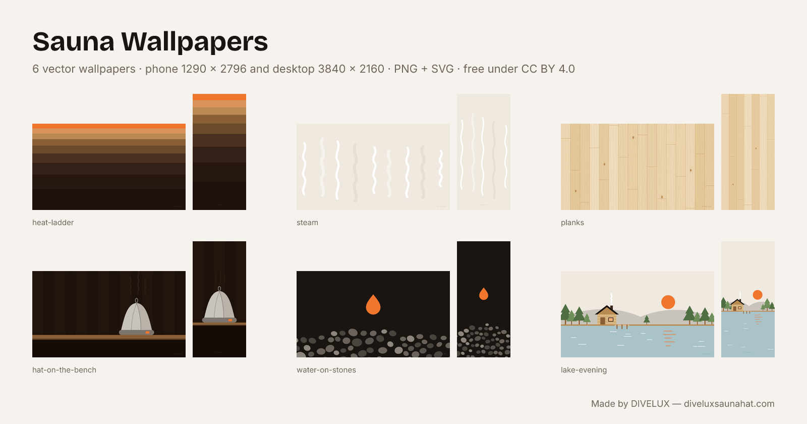

# Sauna Wallpapers

6 minimal vector wallpapers on a sauna theme, each in two sizes: phone (1290 x 2796) and desktop (3840 x 2160). Flat shapes, a warm palette of paper, wood and dark ink, one ember accent, no text apart from a tiny wordmark.

Made by DIVELUX, makers of handmade wool sauna hats — https://diveluxsaunahat.com



## What is inside

| Path | What it is |
|---|---|
| `phone/` | 6 wallpapers, 1290 x 2796, PNG and SVG |
| `desktop/` | 6 wallpapers, 3840 x 2160 (4K), PNG and SVG |
| `preview.png` | all twelve on one sheet |
| `src/build.py` | the script that draws them; every wallpaper is a function of the canvas size |
| `LICENSE` | CC BY 4.0 for the artwork, MIT for the script |

## Wallpapers

| Name | What it shows | Mood |
|---|---|---|
| `heat-ladder` | bench tiers as bands of color, warmer with every step up, ember at the top | dark |
| `steam` | slow white steam wisps on warm paper | light |
| `planks` | light sauna boards with grain, joints and a few knots | light |
| `hat-on-the-bench` | a grey felt bell hat resting on the bench of a dark sauna | dark |
| `water-on-stones` | one ember drop above a bed of stove stones | dark |
| `lake-evening` | a small sauna cabin, a dock, pines and the evening sun over a lake | light |

The phone versions keep the top third quiet, where the clock sits. The desktop versions keep the left side free for icons where the composition allows it.

## Other sizes

The PNG files scale down cleanly to smaller screens with the same proportions (for example 1920 x 1080 or 2560 x 1440). For a different shape, add a line to `SIZES` in `src/build.py` and run it:

```
pip install resvg-py fonttools pillow
python3 src/build.py
```

Or open an SVG in any vector editor and export the size you need.

## License and credit

Free for personal and commercial use under [CC BY 4.0](https://creativecommons.org/licenses/by/4.0/). If you share or adapt the wallpapers, please credit:

> Wallpapers by DIVELUX — diveluxsaunahat.com

More free sauna tools: https://diveluxsaunahat.com/pages/sauna-tools
